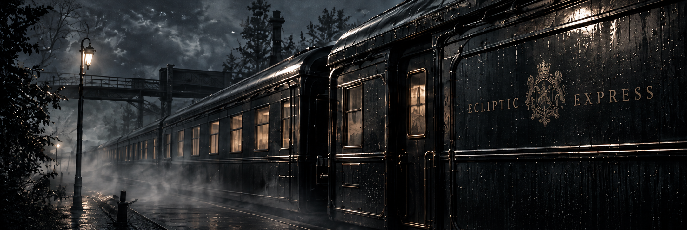
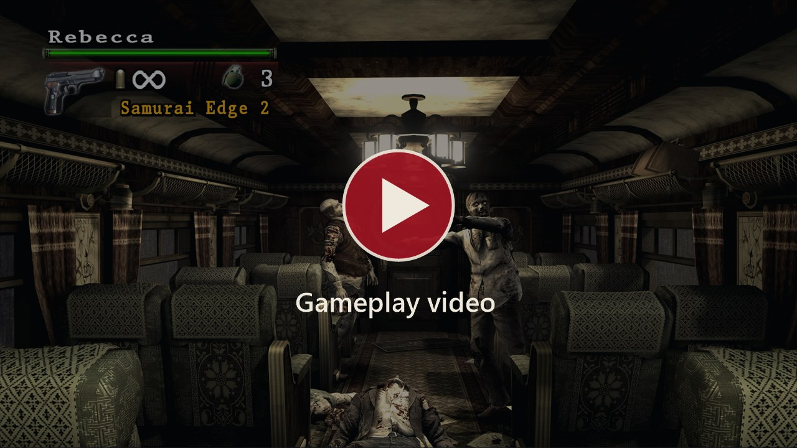
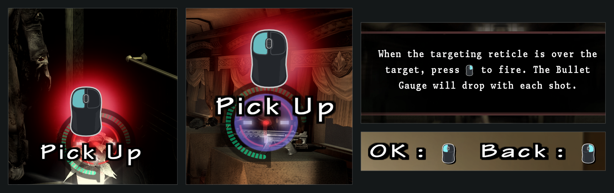
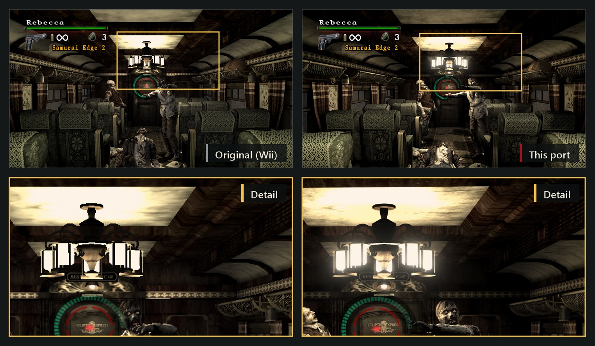
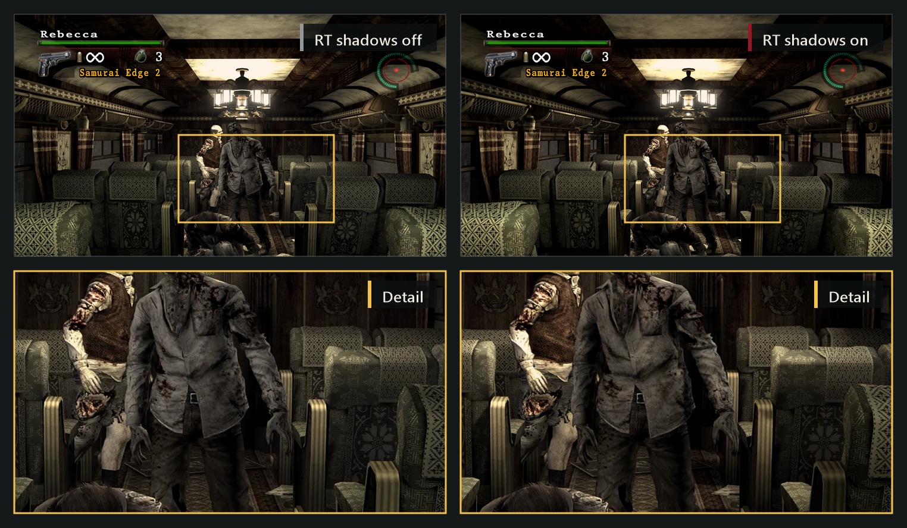
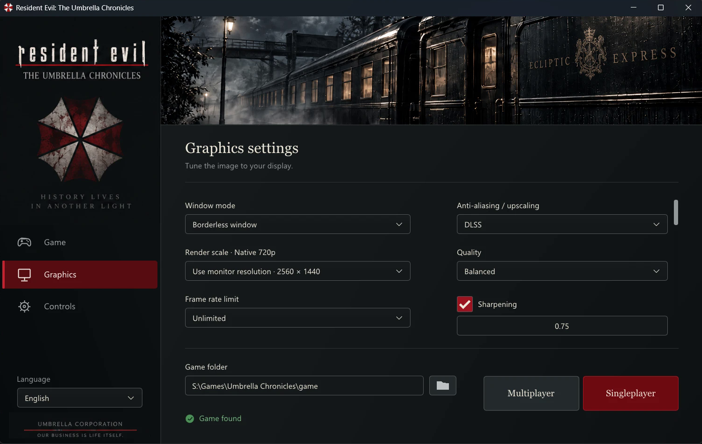
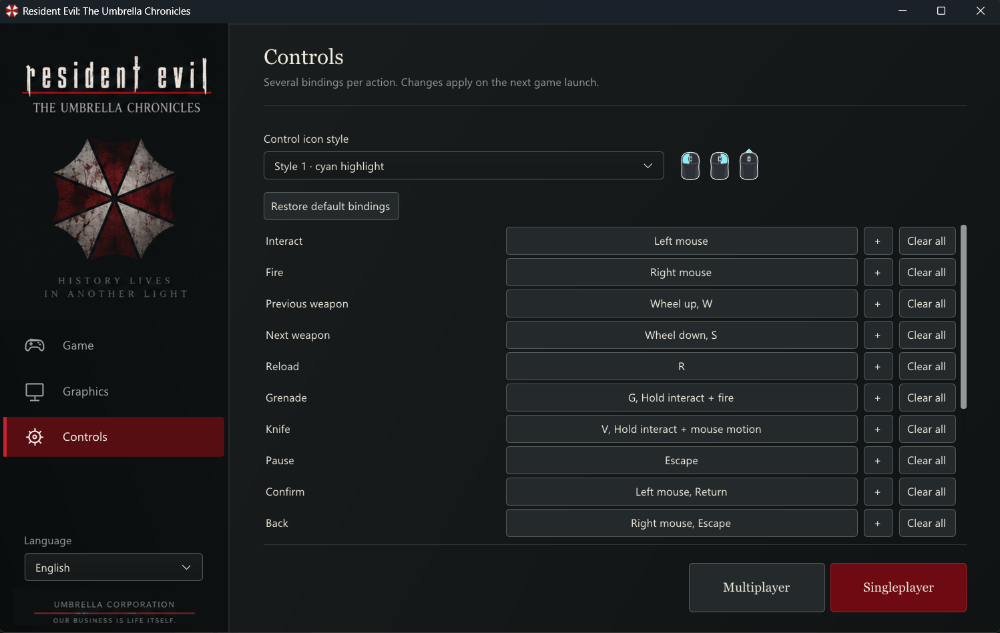
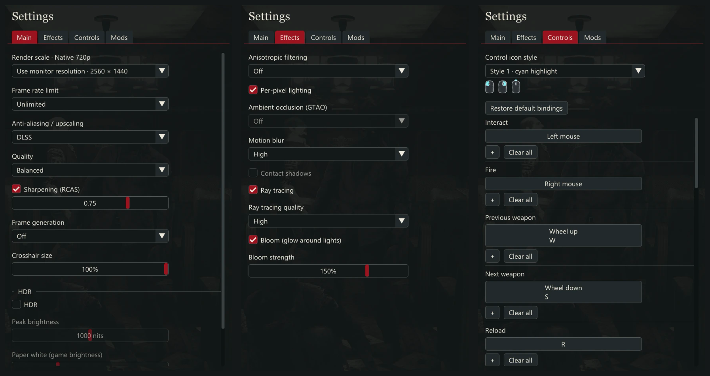
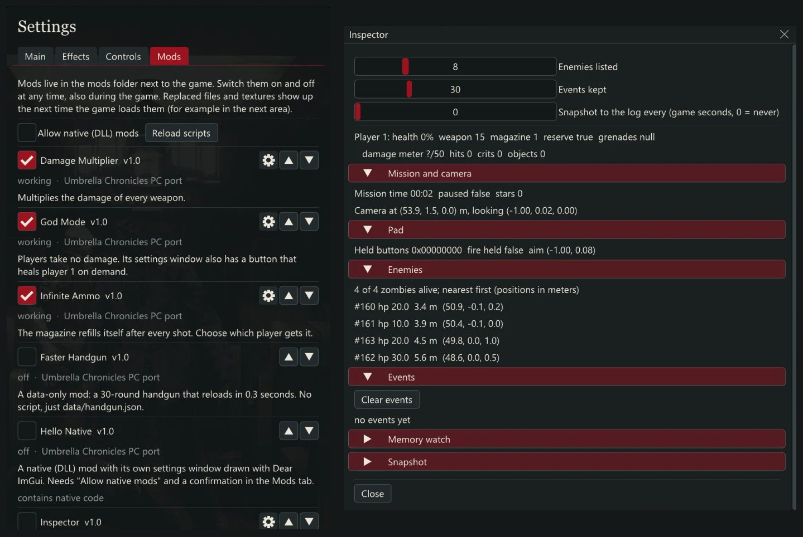

<div align="center">

# Resident Evil: The Umbrella Chronicles — PC native port (recompilation)

**The Wii game running natively on Windows: very fast loading, unlocked FPS, native ultrawide, mouse, gamepad, light gun and Wii Remote aiming, DLSS / FSR, frame generation, ray-traced shadows, HDR, mods and online co-op.**

**English** · [Русский](README.ru.md)

[](LICENSE)
[](#early-build-please-read)
[](https://discord.gg/njy2CqecyY)
[](https://github.com/solleo95/reuc-recomp/releases/latest)

[Video](#gameplay-video) · [Features](#features) · [Installation](#installation) · [Multiplayer](#multiplayer-online-co-op) · [Modding](#modding) · [Building](#building-from-source) · [Contributing](CONTRIBUTING.md) · [Credits](#credits) · [License](#license)



</div>

## Early build: please read

> [!WARNING]
> **This is a very early build and development is still very active.**
>
> The game is already **very playable**, but it has been tested **only on the author's hardware**, so some problems and bugs are quite likely on yours.
> Please report them in the [Issues](https://github.com/solleo95/reuc-recomp/issues) or on the [Discord server](https://discord.gg/njy2CqecyY).
>
> **Multiplayer is still quite raw:** it has a number of known problems and has not been tested much. See [Multiplayer](#multiplayer-online-co-op).

When you report a problem, please say what GPU, driver and Windows version you use, and describe how to reproduce the problem (see [Reporting problems](#reporting-problems)).

> [!IMPORTANT]
> **No game files are included and none will ever be.** This is not a piracy tool. You need your **own copy** of the game (a disc image of _Resident Evil: The Umbrella Chronicles_ for the Wii, region **NTSC-U, game ID `RBUE08`**), and you unpack it yourself: the launcher does it with the built-in [Wit](https://wit.wiimm.de/wit/), or you run Wit by hand. See [Installation](#installation). The project is not affiliated with, endorsed by or connected to Capcom, Nintendo, NVIDIA or AMD.

## Gameplay video

<p align="center">
  <a href="https://www.youtube.com/watch?v=CSk3iaN37Rw"></a>
</p>

## Contents

- [Gameplay video](#gameplay-video)
- [Features](#features)
- [System requirements](#system-requirements)
- [Installation](#installation)
  - [1. Download the port](#1-download-the-port)
  - [2. Unpack your game image (in the launcher or with Wit)](#2-unpack-your-game-image-in-the-launcher-or-with-wit)
  - [3. First launch and settings](#3-first-launch-and-settings)
  - [4. Updating](#4-updating)
- [In-game menu and controls](#in-game-menu-and-controls)
  - [Ultrawide and the HUD](#ultrawide-and-the-hud)
- [Multiplayer (online co-op)](#multiplayer-online-co-op)
- [Known issues](#known-issues)
- [Reporting problems](#reporting-problems)
- [Modding](#modding)
- [Building from source](#building-from-source)
- [Contributing](#contributing)
- [License](#license)
- [Credits](#credits)

## Features

### Native execution and performance

- **Native code, no emulator.** The game's PowerPC program is statically translated to native x86-64 code ahead of time and runs directly on your CPU, with its own Windows runtime and a Vulkan, DirectX 11 or DirectX 12 renderer (your choice in the launcher) instead of the Wii's GPU.
- **High performance and unlocked FPS.** Frame-rate limit presets up to 240 FPS or no limit at all, instead of the original 30. The build uses ThinLTO and profile-guided optimisation, and the hot paths of the Wii SDK are replaced by native code.
- **Very fast loading.** Scenes, menus and chapter changes load far quicker than on the console: the game's files are read straight from your drive by native code.
- Shaders and pipelines are warmed up before the game starts, so shader compilation does not cause stutters during play.
- Windowed, borderless and exclusive fullscreen modes, any resolution and an adjustable internal render scale.
- **Native ultrawide.** On 21:9, 32:9 and any other screen wider than 16:9 you see a real wide picture, with more of the world on the sides and no black bars, cropping or stretching. The aim, pickups and hit detection cover the whole screen. Menus, text and button prompts keep their normal shape; movies stay 16:9. Taller windows (4:3, 16:10) work too. Details: [Ultrawide and the HUD](#ultrawide-and-the-hud).

### Controls built for PC

- **Very comfortable, responsive mouse control.** Raw relative mouse input without acceleration or smoothing, with the aiming latency reduced so the crosshair follows your hand. The original Wii-remote gestures (knife, quick-time events, grenade) work with the mouse and the keyboard.
- **Mouse sensitivity slider** (10-300%, default 100%) at the top of the **Controls** page in the launcher and in the in-game menu. It changes the aim speed at once; shake and swipe gestures keep working the same way.
- **Gamepad support.** Xbox, PlayStation (DualShock 4, DualSense), Nintendo Switch Pro and most other gamepads work as soon as they are plugged in. The left stick aims, the right stick is the analog stick of the Wii Nunchuk (it moves the camera), and the buttons follow the usual layout. A gamepad with a motion sensor can also aim by tilting it: swing it for the knife, shake it to break free. Motion aiming is off by default.
- **Gamepad settings** are on the **Controllers** page (launcher and in-game menu): choose keyboard and mouse, gamepad or automatic, pick the gamepad model, and press **Gamepad** to change stick roles, dead zones, motion aiming and every button. The **Controls** page stays for keyboard and mouse.
- **Light guns (Sinden, GUN4IR, Retro Shooter Reaper, Dolphin Bar in a mouse mode).** Set **Pointing device** to **Light gun (absolute pointer)** on the **Controls** page and the crosshair follows where the gun points instead of adding up mouse motion (which makes a gun drift like a trackball). **Aim smoothing** steadies a shaky pointer. **Reload by shooting at the screen edge** turns a shot in a corner or near an edge into a reload, for guns that have no off-screen reload. Setup per device: [Light guns and the Wii Remote](docs/lightguns.md).
- **Wii Remote.** A Wii Remote paired through Windows Bluetooth, or a Mayflash DolphinBar in mode 4, works directly, with no extra program: the pointer from its infrared camera (you need a sensor bar), the buttons, a Nunchuk, swings for the knife and shakes. Its settings and bindings are in the **Wii Remote** window on the **Controllers** page. Pairing steps and the default layout: [Light guns and the Wii Remote](docs/lightguns.md). Not tried on real hardware yet.
- **On-screen hints and prompts show the controller you play with:** mouse and keyboard icons, Xbox, PlayStation and Nintendo button pictures for a gamepad, or the Wii Remote's own buttons when you used the remote last (and they update when you rebind a key).
- **Aim reticle you can restyle.** The **Reticle** tab of the in-game menu hides the aim trail, the laser dot, the white marks and the green ammo arc, sets a colour for each player, the size of the laser dot and the length of the trail, and fades your partner's reticle in co-op. In single-player the laser dot sits right under the mouse and the trail follows the real path of your hand.
- Every action can be rebound in the launcher and has several bindings; mouse buttons, the wheel, gamepad buttons and key combinations are supported. The key that opens the in-game menu can be changed too.
- Keyboard and mouse, a gamepad, a light gun or a Wii Remote: the choice is yours. The in-game menu opens with **Insert** by default (see [In-game menu](#in-game-menu-and-controls)); the gamepad cannot move around the menus yet, use the mouse there.



### Improved graphics

- **Upscaling:** NVIDIA **DLSS** (Super Resolution and DLAA, all quality modes) and AMD **FSR 3.1** (any GPU). The HUD is drawn at full output resolution, so it stays sharp.
- **Frame generation:** NVIDIA **DLSS Frame Generation** (2x on RTX 40, up to 6x on RTX 50) and **FSR 3.1 Frame Generation** (works on GPUs without RTX). The HUD is excluded from interpolation. With NVIDIA Reflex for low latency.
- **Ray tracing** (GPUs with ray query support): ray-traced shadows from the sun and the lamps, with our own denoiser; **DLSS Ray Reconstruction** on RTX GPUs. More ray-traced effects are in development.
- **Native HDR output** (HDR10) when Windows HDR is on.
- **Improved effects:** our own floating-point bloom, ambient occlusion (GTAO), contact shadows, per-pixel lighting, SMAA, 16x anisotropic filtering and motion blur — each one can be switched on and off separately.
- **Optional DLSS 5** (Neural Rendering) for supported NVIDIA GPUs. The DLSS 5 runtime is not part of this project and is not distributed with it: you place `nvngx_dlssnr.dll` next to `uc.exe` yourself, and only then the DLSS 5 option appears. Off by default.
- High-resolution **texture replacement** (see [Modding](#modding)).





Details: [Upscaling and frame generation](docs/upscaling.md) · [Graphics effects](docs/graphics-effects.md).

### Launcher

- Built-in **launcher in 13 languages**: English, Русский, Deutsch, Français, Español, Italiano, Português, Polski, Українська, Türkçe, 日本語, 한국어, 简体中文.
- All settings in one place: resolution, window mode, ultrawide HUD position, FPS limit, upscaler, frame generation, effects, ray tracing, HDR, DLSS 5, key bindings, mouse sensitivity, pointing device (mouse or light gun) and reload zone, gamepad and Wii Remote settings. Features your GPU cannot run are greyed out with the reason.
- **Unpacks your game image for you:** choose the disc image in the launcher and it unpacks it itself with the built-in Wit, no manual steps ([details](#way-a-the-launcher-unpacks-the-image)).
- **One-click updates:** the launcher checks the latest release, verifies the files (SHA-256) and replaces them, keeping your settings, saves and mods.
- Multiplayer lobby with automatic router port opening (UPnP) and NAT punching ([details](#multiplayer-online-co-op)).

<p>
  
  
</p>

### Extensive modding

- Mods are folders in `mods/` that you can switch on and off **while the game is running**.
- You can change **practically any resource**: textures (DDS), audio (OGG / WAV), text and fonts, any file of the disc, archives, movies, and weapon and game data without writing code.
- **Scripts in Lua and JavaScript** with a documented game API (players, weapons, enemies, camera, input, events, UI, settings), plus **hooks** into the game's own functions.
- **Native DLL mods** for anything that scripts are too slow or too limited for.
- Example mods in [`mods-examples`](mods-examples) (infinite ammo, god mode, randomizer, inspector, native DLL and more).

See [Modding](#modding).

### Online co-op

- Two-player network co-op over LAN or the Internet, with automatic port opening on routers that support UPnP and manual NAT punching. See [Multiplayer](#multiplayer-online-co-op). **Currently raw and little tested.**

## System requirements

The port has been tested only on the author's PC (NVIDIA GeForce RTX 4080, Windows 11), so the minimum requirements are not determined yet. What is known:

|                                      |                                                                                               |
| ------------------------------------ | --------------------------------------------------------------------------------------------- |
| **OS**                               | Windows 10 / 11, 64-bit                                                                       |
| **CPU**                              | x86-64 with **AVX2** (Intel Haswell / AMD Excavator or newer)                                 |
| **GPU**                              | A GPU with **Vulkan 1.3** support and an up-to-date driver                                    |
| **DLSS and DLSS Frame Generation**   | NVIDIA GeForce RTX (frame generation 2x on RTX 40, up to 6x on RTX 50)                        |
| **FSR 3.1 and FSR Frame Generation** | Any GPU with Vulkan 1.3 — **RTX is not required**                                             |
| **Ray tracing**                      | A GPU with ray query support (the launcher shows if yours has it)                             |
| **DLSS 5**                           | Optional; NVIDIA RTX GPU and the `nvngx_dlssnr.dll` runtime that you provide yourself         |
| **Game**                             | Your own image of _Resident Evil: The Umbrella Chronicles_ for the Wii, **NTSC-U (`RBUE08`)** |

> [!NOTE]
> Only the North American release (`RBUE08`) is supported. The translated game code is tied to the exact `main.dol` of that release, so the PAL (`RBUP08`) and Japanese (`RBUJ08`) versions will not work.

## Installation

### 1. Download the port

1. Open the [Releases page](https://github.com/solleo95/reuc-recomp/releases/latest) and download **`UC-Windows-X.Y.Z.zip`**.
2. Unpack it into a folder where you have write permission (for example `C:\Games\Umbrella Chronicles`; **not** `Program Files`). The archive contents go directly into that folder: you will see `uc_launcher.exe`, `uc.exe` and several DLL files.

### 2. Unpack your game image (in the launcher or with Wit)

The port does not contain the game. It reads the game's files from a folder where **your own** disc image is unpacked (the folder that contains `DATA`). There are two ways to get it, pick one: the launcher unpacks the image for you (**way A**, the easiest), or you unpack it yourself with Wit (**way B**).

**What you need (both ways):** an image of your own disc of the NTSC-U version (`RBUE08`) in `.iso`, `.wbfs`, `.ciso`, `.wdf` or `.wia` format, and about 4 GB of free disk space. (The `.rvz` format of Dolphin is not supported: convert it to ISO in Dolphin first, _right-click the game → Convert File…_. Discs in a drive are not supported either: use an image.) You can dump your disc with a Wii and homebrew software.

#### Way A. The launcher unpacks the image

The unpacking tool **Wit** (Wiimms ISO Tools) is already built into the port (the `tools\wit` folder), so there is nothing to download and no command to type.

1. Run **`uc_launcher.exe`**. If the game is not found yet, the launcher asks you to select the extracted game folder.
2. Click the **disc button** (the round disc icon, tooltip _"Select a disc image…"_) to the right of the folder button and choose your image file. You can also paste the path of the image into the **Game folder** field. The message under the field changes to _"Disc image selected. It is unpacked into the game folder before the game starts."_
3. Press the red **Singleplayer** button. The **Unpacking the game** window opens with a progress bar and a **Cancel** button. It takes about a minute.
4. When it is done, the launcher sets the **Game folder** to the new `game` folder next to `uc.exe` and starts the game by itself. The next time just press **Singleplayer**: the image is not needed any more, you can keep it or delete it.

What to know:

- **Only the NTSC-U image (`RBUE08`) is accepted.** The launcher reads the disc ID first. An image of another region, or a file that is not a disc image, is refused with a message, and nothing on your disk is changed.
- **The `game` folder next to `uc.exe` is replaced.** When the image is accepted, the launcher **deletes the old `game` folder** (if there is one) and unpacks the game into a new one. If you put your own files into that folder, back them up first. The old folder counts as free space, so 4 GB free *after* deleting it is enough.
- **The image must not be inside the `game` folder** (it would be deleted together with it): move it somewhere else. The launcher tells you if you picked such a file.
- **A half-unpacked game is never left behind.** If you press **Cancel** or the unpacking fails (damaged image, disk full) or `DATA\sys\main.dol` is missing at the end, the half-unpacked `game` folder is removed. If this happens after the old `game` folder was deleted, there is no `game` folder until you select the image and press **Singleplayer** again.
- The path of the image is **not saved** in `config.json`: until the unpacking succeeds, the launcher keeps the folder that was set before.
- **Multiplayer** stays unavailable until the game is unpacked: first press **Singleplayer** once.
- The game is always unpacked into `game` next to `uc.exe`. If you want it in another folder, use way B.

Messages you may see: _"The Wit tool is missing next to the launcher"_ (the `tools\wit` folder was deleted: reinstall or update the port); _"This is not an image of the NTSC-U disc (RBUE08)"_; _"Not enough free disk space"_; _"The image is inside the game folder"_; _"Unpacking failed: the image may be damaged or the disk is full"_.

#### Way B. Unpack by hand with Wit

Use it if you want the game in another folder or do not want the launcher to touch the `game` folder.

1. Download **Wit** for Windows from <https://wit.wiimm.de/wit/> and unpack it somewhere, for example to `C:\Tools\wit`.
2. Open **PowerShell** or the command prompt in the folder with the port (where `uc.exe` is) and run (change the paths to yours):

   ```powershell
   C:\Tools\wit\bin\wit.exe extract "C:\Images\Umbrella Chronicles.iso" ".\game"
   ```

   `wit extract` (short form `wit x`) writes the whole disc into the `game` folder. It takes a minute and needs about 4 GB of free space.

3. Check the result. The file **`game\DATA\sys\main.dol`** must exist. The structure should look like this:

   ```
   uc.exe
   uc_launcher.exe
   game\
   ├─ DATA\
   │  ├─ files\        (the game's data)
   │  └─ sys\
   │     └─ main.dol
   └─ UPDATE\
   ```

4. _(Optional)_ Check that the image is the right one. The SHA-1 of the file should be `7ed67efe2ba9b0de1cef0bbb2ea157d7a43d7f25`:

   ```powershell
   certutil -hashfile "game\DATA\sys\main.dol" SHA1
   ```

If you unpacked the game into another folder, you will select it in the launcher at the next step. The folder you choose must be the one that **contains `DATA`**.

### 3. First launch and settings

1. Run **`uc_launcher.exe`**. If the launcher says _"Select the extracted game folder"_, click the **Game folder** field and pick the folder from step 2 (the one that contains `DATA`), or choose your disc image with the disc button and press **Singleplayer** (the launcher unpacks the image first, see [way A](#way-a-the-launcher-unpacks-the-image)). A green check mark means the game is found.
2. Choose the language of the launcher (top of the window), the resolution and the window mode.
3. Set the graphics options. Good starting point:
   - **Upscaler:** DLSS (RTX GPU) or FSR (any GPU), mode _Quality_. Without an upscaler the game renders at your resolution as is.
   - **Frame generation:** leave it off until the game runs well, then try it. Choosing a generator also turns on the matching upscaler.
   - **Ray tracing, DLSS Ray Reconstruction, HDR:** only if your GPU supports them; entries that are not available are greyed out with an explanation.
   - **FPS limit:** the limit also sets how often the game simulation steps. With frame generation the displayed FPS is the limit multiplied by the generator multiplier.
4. Open the **Controls** page if you want to change key bindings or the mouse sensitivity. Playing with a gamepad? Plug it in and open the **Controllers** page: pick the gamepad model if it is not detected right and press **Gamepad** to change its settings. Playing with a light gun? Set **Pointing device** to **Light gun** on the **Controls** page. Using a Wii Remote? Connect it first (see [Light guns and the Wii Remote](docs/lightguns.md)), then open the **Controllers** page and press **Wii Remote**.
5. Press the red **Singleplayer** button to start the game (**Multiplayer** is next to it).

On the **first start** the launcher runs a short CPU calibration and the game compiles its shaders and pipelines before it shows the picture. The first start takes longer; later starts are faster.

Everything the launcher changes is saved at once to `config.json` next to `uc.exe`. Your saves are in the `saves` folder. Do not run the game from a read-only location.

You can change most of the graphics options **in the game** as well: press **Insert**.

### 4. Updating

The launcher checks for a new release when it starts and offers **Update** or **Later**. After you agree it downloads the archive, verifies it, restarts and replaces the files. `config.json`, `saves`, `mods`, `textures`, `game` and your own files are kept. Close the game before updating. More details: [docs/releasing.md](docs/releasing.md) (in Russian).

## In-game menu and controls

- **Insert** opens the in-game menu over the game: graphics and effects (live, without restarting the game), DLSS / FSR and frame generation, DLSS 5, key bindings, mouse sensitivity, gamepad settings, the **Reticle** tab and the **Mods** tab where you switch mods on and off while playing. Press Insert again to close it. You can bind another key to the menu on the **Controls** page ("Settings menu").
- Aiming is done with the mouse, the main actions are on the mouse buttons and the wheel; the full list, rebinding and the mouse sensitivity slider are in the launcher's **Controls** page and the in-game menu.
- With a gamepad: the left stick aims (or tilt the pad if it has motion controls and you switched them on), the right stick moves the camera, **right trigger** fires, **A** interacts, **X** reloads, **B** is the knife, **Y** is the grenade, **Start** pauses and clicking the **left stick** puts the aim back in the centre. Everything can be changed on the **Controllers** page (button names follow your gamepad: on PlayStation pads they are Cross, Circle, Square, Triangle).
- A gamepad that works through the Xbox driver (for example the GameSir G7 Pro in Xbox mode) gives the game no motion sensor, so motion aiming is not available with it.
- With a light gun: set **Pointing device** to **Light gun** (**Controls** page or in-game menu, applied at once). The cursor is hidden and kept inside the game window, so use windowed or borderless mode (the Sinden border must stay visible). Gun buttons arrive as mouse buttons: bind **Fire** to the trigger and **Reload**, **Knife** and **Grenade** to the other buttons on the **Controls** page, or turn on **Reload by shooting at the screen edge** (**Corner** or **Edge**, zone size 1-20%).
- With a Wii Remote: point at the screen to aim; **B** (trigger) fires, **A** interacts, **1** reloads, **2** is the grenade, **+** and **-** change weapon, **Home** pauses. With a Nunchuk the stick moves the camera, **Z** is the knife and **C** reloads. Hold **A** and swing the remote for the knife, shake it for the shake prompts. Everything can be changed in the **Wii Remote** window of the **Controllers** page.
- For `config.json` and the command line: `"pointer": "relative"` or `"absolute"` (`--pointer relative|absolute`), `"pointer_smoothing"` 0-90, `"reload_zone"` `"off"`, `"corner"` or `"edge"`, `"reload_zone_size"` 1-20, and a `"wiimote"` object. The launcher writes all of them for you.
- **Alt** releases the mouse cursor in windowed mode. **Esc** pauses.



### Ultrawide and the HUD

- Ultrawide is on by default and follows the shape of the window, also while you resize it. Turn it off with `"ultrawide": false` in the `graphics` section of `config.json` or with `--no-ultrawide` (there is no switch in the launcher) to get the old 16:9 picture stretched over the window.
- **HUD position** (launcher display page and the in-game menu's main tab, applied at once): **Automatic**, **Centre (16:9)** or **Screen edges**. Automatic keeps the health, ammo and weapon panel at the screen edges up to about 21:9 and in the middle on wider screens.
- In online co-op, deterministic runs and recorded demos the game keeps its 16:9 picture, stretched over a wide window. This keeps all players in sync.

## Multiplayer (online co-op)

> [!WARNING]
> **Multiplayer is raw and has not been tested much.** Expect connection problems, desynchronisation, and rough moments after a lag spike. Please report what you see on [Discord](https://discord.gg/njy2CqecyY) or in the [Issues](https://github.com/solleo95/reuc-recomp/issues). Technical notes and the known problems: [docs/testing/netplay.md](docs/testing/netplay.md).

Two players play the game together over the network. Only the players' inputs and checksums go over the network; each PC runs the whole game and draws its own picture at its own frame rate.

**Before you start**

- **Both players need the same version of the port** (the same release, and the launcher updated) **and the same game data** (`RBUE08`).
- The joining player plays on a **temporary copy of the host's saves**; the personal saves of both players stay untouched.
- **Mods are disabled** in network play.
- There is **no password and no encryption**. Play only with people you trust and share your address only with them.

### Hosting a game

1. In the launcher, press **Multiplayer**, then **Create host**.
2. The window shows two addresses, each with a **Copy IP:port** button:
   - **Internet** — your public IP address and port. The launcher tries to open the port on your router **automatically (UPnP)**; the window tells you if it succeeded.
   - **Local network** — for a friend in the same home network. If you have several network adapters, pick the right one in the list.
3. Send the address to your friend (the Internet one for a friend elsewhere, the local one for a friend in your LAN) and wait. The game starts by itself for both players as soon as the connection is made.

The default port is **27888** (TCP and UDP). If it is busy, a free port is chosen, and the window shows the port in use.

### Joining a game

1. Press **Multiplayer**, enter the host's address in the form `IP:port` (for example `203.0.113.5:27888`), press **Connect**.
2. The game starts by itself when the connection is made. **Cancel** closes the lobby.

### If the connection fails

Go through these steps in order.

**1. Windows Firewall / antivirus.** On the first start Windows asks whether to allow the network access: allow **`uc_launcher.exe`** and **`uc.exe`** (both TCP and UDP, private and public networks). If the question did not appear, add the rules manually: _Windows Security → Firewall & network protection → Allow an app through firewall_. Third-party antivirus firewalls (ESET, Kaspersky and others) need the same rules. This must be done by **both** players.

**2. Automatic port opening (UPnP).** For the host the launcher asks the router to forward the port. This works only if UPnP is enabled in your router. If the window says _"Automatic port forwarding unavailable"_, do the next step.

**3. Manual port forwarding (on the host's router).**

1. Find the host PC's local address (for example `192.168.1.10`; it is shown in the **Local network** row). Better to make it permanent with a DHCP reservation in the router.
2. Open your router's web interface (usually `192.168.0.1` or `192.168.1.1`) → _Port forwarding_ / _Virtual server_ / _NAT_.
3. Create rules that forward **port 27888, protocols TCP and UDP**, to the host PC's local address and the same port.
4. Give the friend your **external** IP address (the _Internet_ row of the lobby, or any "what is my IP" site) and the port.

**4. NAT punching (without changing the router).** Use this when the friend cannot connect directly and port forwarding is not possible:

1. The friend (client) enters the host's `IP:port` and presses **Connect**. When the direct connection fails, the window says _"Connection failed"_ and shows the friend's own **public IP:port** (it is found automatically; wait a few seconds). The friend **copies it and sends it to the host**.
2. The host, with the lobby open, expands the **Punch NAT** section, pastes the friend's `IP:port` into the field and presses **Punch NAT**.
3. **Keep both windows open.** The friend's client retries the connection automatically and the game starts as soon as the connection succeeds.

NAT punching works with most home routers. It will not work if either side has **symmetric NAT** (the launcher warns about it) or if the provider uses **CGNAT / double NAT** (the lobby shows that the router has no public IPv4 address). In these cases use port forwarding or a VPN.

**5. VPN or a virtual LAN.** If nothing else helps (CGNAT, a strict provider), both players install a virtual network such as ZeroTier, Tailscale, Radmin VPN or WireGuard and use the _virtual_ IP address of the host in the **Local network** field. This does not need any port forwarding.

**Other checks**

- Check the address and the port: they must be exactly what the host's lobby shows.
- The host must keep the lobby window open until the client connects.
- A connection from the same PC or the same home network always uses the **local** address.
- If the game connects but is slow, the PC that cannot keep up lowers the shared simulation rate automatically (60 → 30 Hz) instead of dropping the connection.

## Known issues

- Early build, tested on one PC: other GPUs, drivers and CPUs may show problems that the author has not seen.
- Multiplayer: see above. It may fail to connect, desynchronise or freeze for a moment after a network lag.
- Only `RBUE08` (NTSC-U) is supported.
- Not all graphics options work together on all GPUs; unsupported ones are greyed out with a reason.
- Ray tracing currently covers shadows only; other ray-traced effects are not finished.
- Ultrawide: backgrounds across the whole screen (menus, fades) and the glow of the title logo stay stretched, and far to the sides something may appear a little late. Taller windows were checked only in the train car. Online co-op keeps 16:9.
- Gamepads: tested with virtual gamepads and automatic tests only, so tell us if your model misbehaves. There is no camera sensitivity slider yet. Gamepads that talk the Xbox protocol (for example the GameSir G7 Pro in Xbox mode) have no motion sensor in the game. The menus cannot be moved around with a gamepad yet.
- Light guns and the Wii Remote: written from the makers' documentation and the Wii Remote's published protocol, and tested with simulated input only, not with real hardware. The direction of swings and the pointer range of the Wii Remote may need a small correction; two guns or two remotes at once are not supported; the Motion Plus gyro, rumble and the Classic Controller are not supported. Please report what you see.

Found something else? Tell us: [Reporting problems](#reporting-problems).

## Reporting problems

- **[GitHub Issues](https://github.com/solleo95/reuc-recomp/issues)** — bug reports (there is a form) and suggestions.
- **[Discord](https://discord.gg/njy2CqecyY)** — bug reports and suggestions are welcome here too, as well as questions, help and chat.

A useful report has: the **version** of the port (shown in the launcher), your **GPU, driver, Windows version**, which graphics options were on (upscaler, frame generation, ray tracing, HDR), how to repeat the problem, and a screenshot or a short video if it is visual. The released builds do not write log files; builds from source do (the `logs` and `debug` folders next to `uc.exe`), attach them if you have them. Do not attach any game files.

## Modding

Mods change the game without touching the original files. A mod is a folder in `mods/` next to `uc.exe` with a `mod.json` file; you switch mods on and off in the **Mods** tab of the in-game menu (**Insert**).

| You want to…                                               | Guide                                                                                                          |
| ---------------------------------------------------------- | -------------------------------------------------------------------------------------------------------------- |
| Start here, make your first mod in five minutes            | [Modding guide](docs/modding/guide/en/README.md) · [Руководство](docs/modding/guide/ru/README.md)              |
| Replace or add textures                                    | [Textures](docs/modding/guide/en/textures.md) · [Extracting the original textures](docs/texture-extraction.md) |
| Replace music, voices, sounds                              | [Audio](docs/modding/guide/en/audio.md)                                                                        |
| Change text and fonts                                      | [Text](docs/modding/guide/en/text.md)                                                                          |
| Replace any file of the disc, archives, movies             | [Disc files](docs/modding/guide/en/files.md)                                                                   |
| Change numbers (damage, magazine size) without code        | [Data patches](docs/modding/guide/en/data-patches.md)                                                          |
| Write scripts                                              | [Lua](docs/modding/guide/en/lua.md) · [JavaScript](docs/modding/guide/en/javascript.md)                        |
| Use the game API (players, enemies, camera, input, events) | [Game API guide](docs/modding/guide/en/game-api.md) · [API reference](docs/modding/api/README.md)              |
| Hook the game's own functions                              | [Hooks](docs/modding/guide/en/hooks.md)                                                                        |
| Add settings sliders and menus                             | [Settings and UI](docs/modding/guide/en/settings-and-ui.md)                                                    |
| Build a native DLL mod                                     | [Native DLL](docs/modding/guide/en/native-dll.md)                                                              |
| Test and share your mod                                    | [Testing and sharing](docs/modding/guide/en/testing-and-sharing.md)                                            |

Reference pages: [short modding reference](docs/modding/getting-started.md), [recipes](docs/modding/recipes.md), [safety](docs/modding/safety.md) (script mods run in a sandbox, DLL mods have full rights), type definitions for editors: [`uc.d.ts`](docs/modding/uc.d.ts) (JavaScript / TypeScript) and [`uc.lua`](docs/modding/lua/uc.lua) (Lua). Ready-made examples are in [`mods-examples`](mods-examples).



## Building from source

Short version: you need Visual Studio Build Tools (C++), LLVM / `clang-cl`, CMake, Ninja, Python 3.10+, the Vulkan SDK and **your own extracted game image** (`main.dol` is translated to native code during the build). Copy [`local.env.example`](local.env.example) to `local.env`, set `UC_INSTALL_DIR` and run `build.bat`.

Full instructions: [docs/building.md](docs/building.md).

## Contributing

Pull requests, bug reports, translations of the launcher and mods are welcome. Read [CONTRIBUTING.md](CONTRIBUTING.md) first ([на русском](CONTRIBUTING.ru.md)): it describes how to build, test and prepare a pull request. Ideas and questions are best discussed on [Discord](https://discord.gg/njy2CqecyY).

## License

The source code of this project is licensed under the **[GNU General Public License v3.0](LICENSE)** (GPL-3.0). In short: you can use, study, change and share it, and changed versions that you distribute must stay under the same licence with their source available.

**What the licence covers, and what it does not:**

| Component                                                                                                                                        | Licence                                                                                                                                                      |
| ------------------------------------------------------------------------------------------------------------------------------------------------ | ------------------------------------------------------------------------------------------------------------------------------------------------------------ |
| The project's own source code (translator, runtime, renderer, launcher, updater, modding platform, tools, tests, documentation)                  | **GPL-3.0** — [`LICENSE`](LICENSE)                                                                                                                           |
| Third-party libraries built into or shipped with the port: SDL3, Dear ImGui, ENet, MiniUPnPc, Lua, QuickJS-ng, mimalloc, miniz, stb_vorbis, SMAA | Their own licences (permissive, compatible with the GPL) — [`THIRD_PARTY_NOTICES.md`](THIRD_PARTY_NOTICES.md), texts in the `licenses` folder of the release |
| Proprietary runtimes that are shipped as separate DLLs: NVIDIA Streamline / DLSS / Reflex, AMD FidelityFX                                        | Their vendors' licences — they are **not** under the GPL and are not part of the GPL-covered work. [`THIRD_PARTY_NOTICES.md`](THIRD_PARTY_NOTICES.md)        |
| Optional NVIDIA DLSS 5 runtime (`nvngx_dlssnr.dll`)                                                                                              | Not distributed by this project; you obtain it yourself under NVIDIA's terms                                                                                 |
| **The game itself**: code, models, textures, audio, video, text of _Resident Evil: The Umbrella Chronicles_                                      | © Capcom. **Not covered by this licence and not included in the repository.**                                                                                |

**The original game files.** To build or run the port you need the game's files from **your own legally obtained copy**: the build translates your `main.dol` into native code, and the game reads the rest of its data from the unpacked disc at run time. The repository contains no game code, no game assets and no output of the translation (`generated/` is git-ignored). Release archives contain the compiled port and **no** game assets (textures, models, audio, video). Do not post or request disc images, assets or decompiled game code in the issues, pull requests or the Discord server.

_Resident Evil_ and _The Umbrella Chronicles_ are trademarks of Capcom Co., Ltd. Nintendo and Wii are trademarks of Nintendo. NVIDIA, GeForce RTX, DLSS and Reflex are trademarks of NVIDIA Corporation. AMD, FidelityFX and FSR are trademarks of Advanced Micro Devices, Inc. All other names belong to their owners; this project is not affiliated with any of them.

## Credits

- **The author and maintainer:** [solleo95](https://github.com/solleo95).
- **Contributors, testers and everyone on the [Discord server](https://discord.gg/njy2CqecyY)** who tried the early builds and reported bugs — thank you!
- **[Wit — Wiimms ISO Tools](https://wit.wiimm.de/wit/)** for unpacking game images.
- **[Dolphin Emulator](https://dolphin-emu.org/)** — used as a reference for the Wii's behaviour and for comparison screenshots while developing; the SDK function signatures are matched with the format of its signature databases. No Dolphin code is included.
- **[Aurora](https://github.com/encounter/aurora)** (a source-level GameCube / Wii compatibility layer by encounter and the Metaforce project) and **Mario Kart Wiicompiled** — studied as references of how the Wii's GX graphics and the static translation of Wii games can be approached. Ideas only, no code is used.
- **NVIDIA** — [Streamline](https://github.com/NVIDIAGameWorks/Streamline), DLSS, DLSS Frame Generation, Ray Reconstruction and Reflex.
- **AMD** — [FidelityFX SDK](https://github.com/GPUOpen-LibrariesAndSDKs/FidelityFX-SDK) (FSR 3.1 and FSR Frame Generation).
- **Open-source libraries:** [SDL3](https://github.com/libsdl-org/SDL), [Dear ImGui](https://github.com/ocornut/imgui), [SMAA](https://github.com/iryoku/smaa) by Jorge Jimenez et al., [ENet](https://github.com/lsalzman/enet), [MiniUPnPc](https://github.com/miniupnp/miniupnp), [Lua](https://www.lua.org), [QuickJS-ng](https://github.com/quickjs-ng/quickjs), [mimalloc](https://github.com/microsoft/mimalloc), [miniz](https://github.com/richgel999/miniz), [stb_vorbis](https://github.com/nothings/stb), [nlohmann/json](https://github.com/nlohmann/json). Full list and licence texts: [`THIRD_PARTY_NOTICES.md`](THIRD_PARTY_NOTICES.md).
- **Capcom** — for creating the game.
